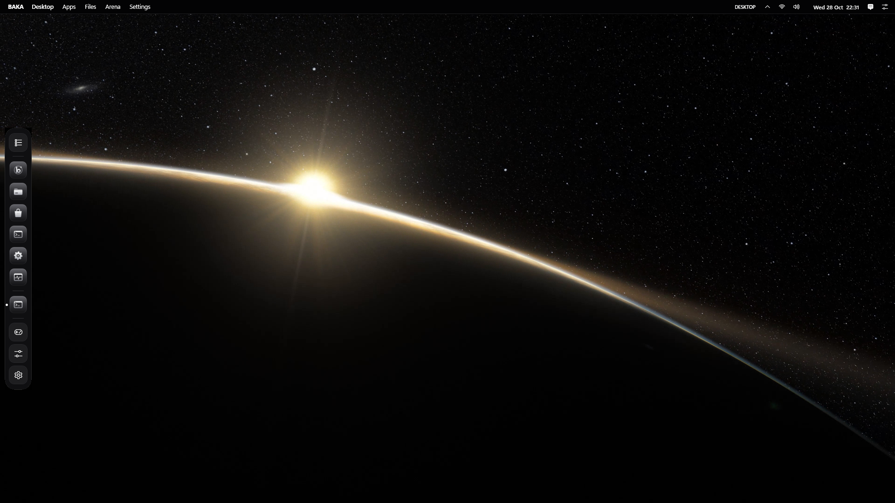

# BAKA Windows Gaming Edition

A custom Windows 11 Pro 26H2 (x64) image for gaming. It replaces the taskbar, Start menu and File Explorer windows with its own desktop, puts BAKA buttons on every app window, plays 4K video wallpapers on the graphics card, removes apps most people never use, blocks ads and trackers for every app, turns off telemetry, and ships [Baka Browser](https://github.com/OldcarryG/Baka-browser) as the default browser. When a game starts, BAKA gets out of the way: its UI, keyboard listener and video wallpaper are switched off, so it adds almost nothing while you play.

Windows itself is not modified: it is Microsoft's own Windows 11 Pro 26H2 (build 26300) with Windows Security, Secure Boot, TPM, the Store, drivers and Windows Update all working. Everything BAKA changes can be undone.

[](https://github.com/OldcarryG/Baka-windows/actions/workflows/source-validation.yml)

**Download:** the full ISO (11.2 GB) is on MEGA, linked from the [R15 release](https://github.com/OldcarryG/Baka-windows/releases/tag/r15-20261029) together with its SHA-256. The newest BAKA Desktop update is in the [latest release](https://github.com/OldcarryG/Baka-windows/releases/latest).

> **No more new ISOs.** R15 is the last ISO for now. From here on BAKA Windows is updated through BAKA Desktop releases: download the zip, run the installer, done ([Update BAKA Desktop](#update-baka-desktop)). A new ISO is only made if Microsoft releases a Windows update that is worth building into the image.

- [Screenshots](#screenshots)
- [Features](#features)
- [BAKA vs normal Windows 11](#baka-vs-normal-windows-11)
- [Benchmark](#benchmark)
- [Input latency](#input-latency)
- [4K video wallpaper](#4k-video-wallpaper)
- [System requirements](#system-requirements)
- [Install](#install)
- [Update BAKA Desktop](#update-baka-desktop)
- [First start](#first-start)
- [Keyboard shortcuts](#keyboard-shortcuts)
- [Undo BAKA](#undo-baka)
- [Known limits](#known-limits)
- [FAQ](#faq)
- [Releases](#releases)
- [Command line](#command-line)
- [Build and source checks](#build-and-source-checks)

## Screenshots


| Launchpad (Windows key) | Search | BAKA Files |
|---|---|---|
|  |  |  |
| **Control Center** | **BAKA Settings** | **BAKA Arena** |
|  |  |  |

BAKA buttons on other apps (Notepad, Calculator, Media Player), captured in the installed VM:


## Features

### Desktop
- **BAKA Desktop** is a compiled app (C#/WPF on .NET Framework 4.8, which ships with Windows). No PowerShell runs for the desktop. It restarts itself after a crash; after three crashes in two minutes it gives back the normal Windows taskbar, so you are never left without a desktop.
- **Menu bar** on top: BAKA menu, Apps, Files, Arena, Settings, the name of the app in front, tray icons, network, volume, battery, clock, notifications and Control Center.
- **Dock** on the left, bottom or right, with pinned and running apps. Menu bar and dock reserve their screen edge like the taskbar, so maximized windows never hide their buttons under them. Fullscreen games and video cover them as they would cover the taskbar.
- **BAKA buttons on every app window**: amber, green and red minimize, maximize and close on Notepad, Store apps (Calculator, Media Player) and most desktop apps. They follow the window when you drag it. Nothing is loaded into other apps, so anti-cheat is not affected. Apps running as administrator, dialogs and fullscreen windows keep Windows' buttons. Can be turned off in Settings > Windows.
- **4K video wallpaper**: MP4, MOV, MKV, WebM, WMV and AVI with H.264, HEVC, VP9 or AV1, up to 4K (higher if your graphics card decodes it). Details [below](#4k-video-wallpaper).
- **Launchpad** (Windows key): every installed app in a grid, and one search box for apps, Windows settings pages and files. It tolerates typos ("setings", "discrod"), knows program names ("cmd", "regedit") and initials ("vsc" for Visual Studio Code). Ctrl+Esc still opens the Windows Start menu.
- **BAKA Files**: sidebar with places and drives (with free space), sortable list, search in the folder and subfolders, copy/cut/paste with the Windows clipboard, drag and drop, delete to the Recycle Bin, rename, new folder or text file, ZIP compress and extract, Open with, Properties, Open Terminal here. Win+E and folders opened from any app open here.
- **Control Center**: Focus and Game overlay switches, Wi-Fi, Bluetooth, Arena, night light, tray icons, display, ad block, volume with **per-app volume** (one slider, mute button and level meter for each app playing sound), brightness (laptops), media controls, profile, power plan, theme and widgets.
- **Notifications**: BAKA reads Windows' own notification list and shows each notification as a BAKA pop-up and in the bell panel (Win+N). Windows' duplicate banners are switched off while BAKA shows the pop-ups, and put back when you leave BAKA.
- **Keyboard shortcut cheat sheet**: hold the Windows key for about 0.7 s (Win+/ keeps it open).
- **BAKA Settings** pages: Appearance (theme, accent, glass, motion, icons), Wallpaper (BAKA wallpapers, any picture, a looping video or a colour, plus the pause options), Dock, Menu bar, Widgets, Windows (BAKA buttons, Windows key, BAKA as the shell, Explorer in the background, Leave BAKA), Privacy & ads, Focus & games (Focus, game overlay, FPS counter permission, Windows banners), Power (power plan, Desktop/Gaming/Benchmark profile) and About.
- **BAKA Arena**: all installed Steam and Epic games in one grid, Desktop and Gaming profiles, live CPU, GPU, memory and network numbers.
- **Widgets**: clock, calendar, system monitor (CPU, GPU, memory, disk, network), GPU, network, storage, quick toggles, search, notes, media controls, focus timer. No news feed and no ads.
- **125 hand-drawn app icons** (Steam, Discord, Spotify, Settings, Store, Terminal, Git, Python, NVIDIA, Riot, VALORANT, Roblox, browsers and more), each drawn in the style of the theme. Apps without a BAKA icon keep their own icon on a BAKA tile.
- **12 themes**: Carbon, Carbon Red, Liquid Glass, four Pop themes, Obsidian, Liquid, Violet, Minimal and Gaming, with accent colours and glass and motion levels.
- BAKA's own windows use the Mica backdrop, so they move as smoothly as Windows 11 apps.

### Gaming and latency
- **Automatic game detection.** A running game (Steam, Epic, GOG, EA, Ubisoft, Xbox, Riot, Battle.net, itch, or any fullscreen app) switches BAKA to **Competitive Gaming**:
  - menu bar, dock, widgets and BAKA window buttons are hidden;
  - the video wallpaper is closed and its decoder and video memory freed;
  - BAKA's **keyboard listener is removed**, so BAKA sees none of the game's key presses;
  - the window-event hooks for the BAKA buttons are removed;
  - transparency and animations are switched off, background apps paused, and BAKA's memory trimmed;
  - BAKA Desktop runs at below-normal priority.

  Everything comes back when the game closes. Arena's Gaming card does the same by hand.
- **Game overlay** (Ctrl+Alt+F): FPS, 1% low, frame time, CPU, GPU load, GPU temperature, video memory, GPU power and RAM in a small see-through strip that clicks pass through. FPS comes from Windows' own graphics event log (ETW, like Xbox Game Bar and PresentMon); nothing is injected into games. FPS needs a one-time permission in Settings > Focus & games (it adds your account to Windows' Performance Log Users group). Temperature, power and video memory need an NVIDIA GPU.
- **Focus** (Ctrl+Alt+D): no notification pop-ups, the dock tucks away and the video wallpaper pauses. It turns on by itself while a game runs.
- **BAKA Gaming power plan**: based on Ultimate Performance, no core parking, games kept on performance cores, no USB selective suspend. Laptops keep Balanced on battery.
- Game Mode on, hardware-accelerated GPU scheduling on, optimizations for windowed games, foreground priority, no network throttling for games.
- Raw mouse input (no acceleration), no Sticky Keys, Filter Keys or Toggle Keys pop-ups.
- Game DVR and Game Bar off. Xbox sign-in is kept for Game Pass and PC games.
- Free AV1, VP9, HEVC and HEIF codecs installed from the Microsoft Store at first sign-in.
- **[Tune it for your hardware with an AI coding tool](docs/OPTIMIZE_WITH_AI.md)**: a ready-made prompt for Claude Code, Codex, Gemini CLI, Cursor, Kiro or similar. The AI inventories your CPU, GPU, RAM, monitor and network, benchmarks first, shows a plan, applies only changes it measured to help, keeps security and anti-cheat requirements on, and writes an undo script.

### Privacy and ads
- **Ads and trackers blocked for every app**, not just the browser: encrypted AdGuard DNS (DNS over HTTPS) plus a BAKA block list in the Windows hosts file for ad, analytics and error-tracking hosts that DNS lists miss. One switch in Settings turns both off.
- **Telemetry off**: DiagTrack, dmwappushservice, Inventory and Compatibility Appraisal, Windows Health and Optimized Experiences, Windows AI Components Host and Distributed Link Tracking services; 16 telemetry tasks; app inventory and application telemetry policies; diagnostic data at the lowest level Windows Pro allows. Windows Pro still sends "required" diagnostic data; BAKA does not claim zero telemetry.
- **Off**: Copilot, Recall, advertising ID, tips and suggestions, Start menu web search, activity history, Spotlight, consumer app installs.

### Apps
- **Removed**: Internet Explorer, legacy Windows Media Player, Movies & TV, WordPad, Steps Recorder, Math Input Panel, Fax and Scan, PowerShell ISE, Clipchamp, Copilot, Xbox app, Game Bar, News, Weather, Office hub, Solitaire, Teams (personal), Bing Search, Outlook (new), To Do, Power Automate, Get Help, Feedback Hub, Dev Home, Phone Link, Cross Device, Quick Assist, Maps, People, Family; Microsoft Edge (the WebView2 runtime that apps need is kept). Removed apps can be installed again from the Store.
- **Kept**: Microsoft Store (WhatsApp, Spotify, To Do and others install and run), Media Player, Photos, Camera, Paint, Notepad, Calculator, Snipping Tool, Terminal, Clock, Sound Recorder, Windows Security, App Installer (winget), Xbox sign-in.
- **Added**: Baka Browser, BAKA Desktop, free AV1/VP9/HEVC/HEIF codecs.

### Baka Browser 1.6.2
Preinstalled and set as the default browser. Chromium engine (WebView2), uBlock Origin Lite added on first start, Chrome Web Store extensions with signature checks, tab menu, drag tabs to reorder or into a new window, mute button, private windows, new-tab dashboard with picture or video background, 4K VP9/AV1/H.264 video, quiet automatic updates. See the [Baka Browser README](https://github.com/OldcarryG/Baka-browser#readme).

## BAKA vs normal Windows 11

| | Normal Windows 11 Pro | BAKA Windows |
|---|---|---|
| Taskbar and Start | Taskbar, Start with recommendations and web results | Menu bar, dock, Launchpad with typo-tolerant search, no web results, no ads |
| Window buttons | Windows' buttons | BAKA amber/green/red buttons on every app |
| File manager | File Explorer | BAKA Files (Explorer still runs hidden for tray, notifications, file dialogs) |
| Wallpaper | Picture, slideshow, Spotlight | Picture, colour, or 4K video decoded on the GPU, paused when covered, closed in games |
| While gaming | Taskbar, widgets, background apps keep running | BAKA UI, keyboard listener and video wallpaper off; BAKA Desktop uses 0.01% CPU and 34 MB |
| Key press latency, median (VM) | 0.27 to 0.28 ms | 0.26 to 0.27 ms gaming, 0.29 to 0.33 ms desktop |
| Windows key → start surface | 30 to 46 ms (Start) | 16 to 19 ms (Launchpad) |
| Fast Startup | On | On (since R15) |
| Power plan | Balanced | BAKA Gaming (Ultimate Performance base) |
| Game DVR / Game Bar | On | Off |
| Mouse acceleration | On | Off (raw input) |
| Ads and trackers (d3ward list, 131 domains) | 2 blocked | **131 blocked** |
| Privacy checks (12) | 0 | **12** |
| Telemetry tasks / services running | 14 / 5 | 0 / 0 |
| Copilot, Recall, ads ID, tips, Spotlight, Start web search | On | Off |
| Microsoft Edge | Installed, default browser | Removed; Baka Browser is the default (WebView2 kept) |
| Installed app packages | 51 | 35 |
| Setup | Account, privacy and Microsoft-account screens | Straight to the desktop; disk choice stays interactive |
| Security (Defender, firewall, Secure Boot, TPM, VBS, updates) | On | On (nothing bypassed) |
| Undo | – | Restore BAKA System Tuning, Settings > Windows > Leave BAKA |

The full comparison, with every setting, is in [docs/BAKA_VS_WINDOWS.md](docs/BAKA_VS_WINDOWS.md).

## Benchmark

Final R14 ISO, measured 2026-10-29. Stock Windows 11 (the official Microsoft ISO, unchanged) and BAKA were installed into identical Hyper-V VMs (Generation 2, Secure Boot, virtual TPM 2.0, 4 vCPU, 6 GB, 64 GB disk). Each VM ran alone, was restarted, signed in, left idle for 10 minutes and measured with the same script. BAKA was measured in Desktop mode and again in Gaming mode (what a running game switches to).

| | Stock Windows 11 | BAKA Desktop mode | BAKA Gaming mode |
|---|---:|---:|---:|
| **Score** (100 = stock) | 100 | 99.4 | **101.7** |
| Score without idle CPU | 100 | 91.4 | 94.0 |
| Idle CPU, 60 s average | 5.5% | **2.6%** | 2.9% |
| Memory in use at idle | **2066 MB** | 2539 MB | 2579 MB |
| Memory committed | **1779 MB** | 2340 MB | 2324 MB |
| Processes / threads | 137 / 1562 | 136 / 1652 | 136 / **1511** |
| Running services | 97 | 90 | **89** |
| Ready scheduled tasks | 211 | **194** | **194** |
| BAKA Desktop's own CPU / memory | – | 0.1% / 57 MB | 0.01% / 34 MB |
| CPU (SHA-256, one core) | 1871 MB/s | 1871 MB/s | 1870 MB/s |
| Memory copy (256 MB) | 18,088 MB/s | 17,517 MB/s | 17,803 MB/s |
| Disk write (1 GB, write-through) | 1620 MB/s | 1509 MB/s | 1619 MB/s |
| Boot time (Windows boot event) | **22.0 s** | 27.8 s | |
| Disk used on C: | **22.0 GB** | 23.8 GB | 23.8 GB |
| Ads blocked (d3ward test, 131 hosts) | 2 | **131** | **131** |
| Privacy checks passed | 0 / 12 | **12 / 12** | **12 / 12** |

What this means:
- **Same speed as stock.** CPU is identical; memory copy and disk write are within 7%, the normal run-to-run range of this VM.
- **BAKA's own cost is small**: 0.1% CPU and 57 MB on the desktop, 0.01% and 34 MB while gaming.
- **Idle CPU** was lower on BAKA this round, mostly because Microsoft Defender was scanning on stock (2.9%). In R13 it was the other way round (BAKA 13.5%, stock 3.6%), so idle CPU is noisy. It also carries the score: without it the score is 91.4 (Desktop) and 94.0 (Gaming).
- **Memory** was about 0.5 GB higher on BAKA. The BAKA VM still had WhatsApp, Spotify and To Do installed and running from the Store test (WhatsApp alone 200 MB); stock had none of them.
- **Boot** was 5.8 s slower on BAKA this round; in R13 it was 2.8 s faster. Boot time varies by several seconds between runs.

The score is the geometric mean of BAKA-vs-stock ratios over boot time, memory in use, memory committed, processes, services, idle CPU, disk used, CPU, memory copy and disk write (Gaming mode without boot time). **Full method, every ratio, the top CPU and memory users of each system, earlier rounds and the scripts to run it yourself: [docs/BENCHMARK.md](docs/BENCHMARK.md).**

Game FPS cannot be measured in a VM without a GPU; use the [AI tuning prompt](docs/OPTIMIZE_WITH_AI.md) to benchmark and tune on your own PC.

## Input latency

Time from an injected key press until the window in front receives it, 200 presses per run, 3 runs, in the same VMs on the same day (R15):

| | Median |
|---|---:|
| Stock Windows 11 | 0.27 to 0.28 ms |
| BAKA Gaming mode | **0.26 to 0.27 ms** |
| BAKA Desktop mode, R15 | 0.29 to 0.33 ms |
| BAKA Desktop mode, R14 | 0.33 to 0.37 ms |
| BAKA Desktop mode, "Windows key opens Launchpad" off | 0.26 to 0.27 ms |

- **While gaming, BAKA is not in the input path at all**: the same as stock.
- **On the desktop BAKA adds 0.02 to 0.06 ms** per key, the cost of listening for the Windows key. Since R15 BAKA only listens (raw input) instead of hooking the keyboard, so Windows never waits for BAKA on a key press. Turning off "Windows key opens Launchpad" brings it to stock.

| Start surface | Stock Windows 11 | BAKA R15 |
|---|---:|---:|
| Windows key → Start / Launchpad in front | 30 to 46 ms | **16 to 19 ms** |
| Win+E → File Explorer / BAKA Files | 175 to 258 ms | **16 to 64 ms** |

**Boot** (restart, same VMs): the Windows boot event is the same as stock within the VM's spread (BAKA 27.0 to 28.8 s, stock 23.0 to 28.5 s). The BAKA desktop is ready 8.8 to 9.6 s after boot start (R14: 10.9 to 11.3 s); Explorer starts at about 7 s on both. R15 also keeps Windows' Fast Startup on, which R14 had turned off, so power-on after a shutdown is no longer a full cold boot. Details: [docs/BENCHMARK.md#r15-boot-shutdown-and-key-latency](docs/BENCHMARK.md#r15-boot-shutdown-and-key-latency).

**The earlier latency fix in R14** (before R15 removed the hook altogether). Windows holds every key press until each low-level keyboard hook answers. Until R13, BAKA's hook ran on BAKA's UI thread, so a key press had to wait whenever BAKA was busy drawing. On the development PC, with BAKA's main thread kept busy like a frame being drawn:

| Design | Median key latency |
|---|---:|
| No hook at all | 0.66 to 0.71 ms |
| R13: hook on the UI thread | **25 to 42 ms** (most presses held more than 50 ms) |
| R14: hook on its own time-critical thread | **0.75 ms** |

Mouse latency and the 1 ms timer could not be measured in Hyper-V. Details: [docs/BENCHMARK.md#input-latency](docs/BENCHMARK.md#input-latency).

## 4K video wallpaper

Settings > Wallpaper > choose a video, or `BakaDesktop.exe --wallpaper <file>`. Windows' own Media Foundation player decodes the video on the graphics card (DXVA) and draws it straight to the screen, without copying frames through the CPU.

| Format | Development PC (RTX 5060) | VM (no GPU, software decoding) |
|---|---|---|
| H.264 MP4 4K | plays and loops, **0.2% CPU** | plays and loops, 36% |
| HEVC MP4 4K | needs the HEVC extension (BAKA installs it) | plays, 50% |
| VP9 WebM 4K | plays, **2% CPU** | plays, 21% |
| AV1 WebM 4K | plays, **0% CPU** | too slow without a GPU |
| A maximized window covers the desktop | – | paused, CPU 37% → 0.05% |
| A game starts | – | closed, CPU 0%; plays again afterwards |

- It plays only while you can see it: it **pauses** when a maximized or fullscreen window covers the desktop, **on battery**, and while the PC is **locked**. Each can be switched off in Settings > Wallpaper.
- While a game runs the player is **closed** (decoder and video memory freed) and it continues afterwards.
- **Fill** crops the video to the screen without black bars; **Fit** shows it whole.
- A video Windows cannot decode falls back to the picture, and Settings > Wallpaper says why.
- AV1 needs a GPU that decodes it (NVIDIA RTX 30 or newer, AMD RX 6000 or newer, Intel Arc or 11th-gen Core graphics or newer). On older GPUs use H.264, HEVC or VP9 for 4K.



## System requirements

The same as Windows 11 Pro; nothing is bypassed:
- 64-bit CPU supported by Windows 11, UEFI with **Secure Boot**, **TPM 2.0**
- 4 GB RAM minimum, 8 GB or more recommended for gaming
- 64 GB disk minimum
- A USB stick of 16 GB or more for installing
- Internet at first sign-in for Baka Browser, codecs and Store apps
- For 4K video wallpapers with almost no CPU use: a GPU with hardware video decoding

## Install

1. Download the ISO from the MEGA link in the [R15 release](https://github.com/OldcarryG/Baka-windows/releases/tag/r15-20261029).
2. Check it: `Get-FileHash .\BAKA-Windows-Gaming-Edition-26H2-x64-BakaDesktop-R15-20261029.iso` in PowerShell must print `D33C2E3900710A96347F47ABE905911E372B5D19C034AC49260B9217E1E18107`, the SHA-256 shown in the release.
3. Write it to a USB stick with [Rufus](https://rufus.ie) (partition scheme GPT, target UEFI), or mount it in a VM (Hyper-V Generation 2 with Secure Boot and a virtual TPM, or VMware with UEFI and a vTPM).
4. Boot from it. Setup asks which disk to install to; it never erases a disk on its own. **Back up your data first** if you install over an existing system.
5. After about 10 minutes you are on the BAKA desktop.
6. Install the newest BAKA Desktop update (next section).

To build the ISO yourself from Microsoft's official ISO, follow [docs/GITHUB_WORKFLOW.md](docs/GITHUB_WORKFLOW.md) and run the scripts in `Scripts/` (needs the Windows ADK Deployment Tools and the .NET SDK).

## Update BAKA Desktop

BAKA Desktop (the menu bar, dock, Launchpad, Files, Control Center, Settings and widgets) is updated on its own, without reinstalling Windows. Settings, wallpapers and pinned apps are kept.

1. Open the [latest release](https://github.com/OldcarryG/Baka-windows/releases/latest) and download **BakaDesktop-&lt;version&gt;.zip**.
2. Right-click the zip > **Extract All**.
3. In the extracted folder, double-click **Install-BakaDesktop.cmd** and approve the administrator prompt. If Windows SmartScreen says "Windows protected your PC", click **More info** > **Run anyway** (the files are not code-signed).
4. BAKA Desktop closes for a few seconds and starts again. BAKA Settings > About shows the new version.

The installer only replaces `C:\ProgramData\BAKA\Desktop\BakaDesktop.exe`. It checks that the PC has BAKA Windows, checks the new file against `SHA256.txt` from the zip, keeps the current one as `BakaDesktop.exe.previous` and pre-compiles the new one (NGen). To go back to the previous version, run `Install-BakaDesktop.cmd rollback` from the same folder. What changed in each version: [docs/CHANGELOG_DESKTOP.md](docs/CHANGELOG_DESKTOP.md).

## First start

- Setup skips the account, privacy and Microsoft-account screens. A local account named **BAKA** signs in by itself without a password. Set a password in Windows Settings > Accounts to get the sign-in screen back.
- In the first minutes, with internet, BAKA installs Baka Browser and the AV1, VP9, HEVC and HEIF codecs in the background.
- Windows Update is **paused** at first so it does not download for an hour on a fresh install. Resume it with the **Restore Windows Update** shortcut in the Start menu's BAKA folder.
- Install your GPU driver (NVIDIA, AMD or Intel) as on any Windows PC.
- Optional: run the [AI tuning prompt](docs/OPTIMIZE_WITH_AI.md) to tune for your hardware.

## Keyboard shortcuts

| Keys | Action |
|---|---|
| Windows key | Launchpad (apps and search) |
| Hold the Windows key (about 0.7 s) | Keyboard shortcut cheat sheet; Win+/ keeps it open |
| Win+S | Search |
| Win+E | BAKA Files |
| Win+N | Notifications (bell panel) |
| Ctrl+Alt+D | Focus on or off |
| Ctrl+Alt+F | Game overlay (FPS, CPU, GPU) on or off, also inside games |
| Ctrl+Alt+G | Leave a game mode you started by hand |
| Ctrl+Esc | Windows Start menu |
| Win+D, Alt+Tab, Win+Tab, Win+L and other Windows shortcuts | Work as usual |

## Undo BAKA

- **BAKA Settings > Windows > Leave BAKA** gives back the Windows taskbar, Start menu and File Explorer.
- **Restore BAKA System Tuning** (Start menu, BAKA folder) undoes BAKA's service, scheduled-task, privacy, power plan and default-browser policy changes from the backup BAKA made at first sign-in. It asks for administrator approval.
- **Restore Windows Update** (same folder) turns Windows Update back on.
- The ad-block DNS and hosts list are turned off with one switch in BAKA Settings > Privacy & ads.
- `BakaDesktop.exe --restore-windows` does the same as Leave BAKA from a command line.
- Removed apps can be installed again from the Microsoft Store or Windows Settings > Optional features.

## Known limits

- **Microsoft Edge** is removed and its reinstall blocked by policy, but in one R12 install Windows put Edge back, so removal is not guaranteed on this Windows build.
- **Store apps that need Edge**, such as Netflix, do not install while Edge is removed (error 0x80073D31).
- **AV1 4K wallpapers** need hardware AV1 decoding (see above).
- **Game FPS, frame times, mouse latency and media keys** were not benchmarked; the test VMs have no GPU and no sound device. The game overlay's FPS counter was checked on a real PC at 60 FPS (a Direct3D 9 window and a DXGI app on a 60 Hz screen), but not yet inside a real game, and not with Vulkan or OpenGL games.
- **Game overlay** shows over borderless and windowed games; a game in exclusive fullscreen draws above it. GPU temperature, power and video memory are read only on NVIDIA GPUs.
- **Windows Pro telemetry**: "required" diagnostic data is still sent; BAKA does not claim zero telemetry.
- **Apps running as administrator** and dialogs keep Windows' own window buttons.
- The ISO is not signed by Microsoft. Check its SHA-256 against the release.

## FAQ

**Does BAKA affect anti-cheat?** BAKA does not load anything into other processes. The BAKA buttons are separate windows that follow the app. With Explorer running in the background (the default) BAKA only listens to the keyboard with raw input; only when you turn Explorer off completely does it use a keyboard hook, on its own thread. Either way it stops listening while a game runs. The game overlay reads FPS from Windows' graphics event log instead of hooking into the game. Secure Boot, TPM, VBS and Defender stay on.

**Is it activated?** BAKA includes no licence key. Activate it with your own Windows 11 Pro licence, as with Microsoft's ISO.

**Can I update Windows?** Yes. Windows Update works normally once you resume it with Restore Windows Update.

**Can I install Chrome, Firefox or Edge?** Chrome, Firefox and other browsers install as usual. Edge is blocked by the Edge Update policy value `Install{56EB18F8-B008-4CBD-B6D2-8C97FE7E9062}` = 0 in `HKLM\SOFTWARE\Policies\Microsoft\EdgeUpdate`; delete that value (and `DoNotUpdateToEdgeWithChromium` in `HKLM\SOFTWARE\Microsoft\EdgeUpdate`) to install Edge again.

**Does the video wallpaper slow games down?** No. It is closed completely while a game runs, and paused whenever a maximized window covers the desktop.

**How do I get the normal Windows desktop back?** BAKA Settings > Windows > Leave BAKA.

## Releases

| Release | Main changes |
|---|---|
| **BAKA Desktop 12.27.1** (2026-10-30, no new ISO) | Update for R15 PCs: game overlay with FPS, Focus, per-app volume, BAKA notification pop-ups without Windows' duplicate banners, shortcut cheat sheet, optional BAKA-as-shell mode with its own tray and Win+Tab, many fixes. [Changelog](docs/CHANGELOG_DESKTOP.md), [how to install](#update-baka-desktop) |
| **R15** (2026-10-29, last ISO) | Fast Startup back on; BAKA Desktop starts with Explorer (desktop ready about 1.7 s sooner); no false crash at every shutdown; Windows key only listened to, not hooked; Launchpad opens in under 20 ms; native image for BAKA Desktop |
| R14 (2026-10-29) | 4K video wallpaper decoded on the GPU; keyboard hook on its own time-critical thread (25–42 ms → 0.75 ms with BAKA busy) and removed in games; AI tuning prompt; ISO on MEGA |
| R13 (2026-10-29) | BAKA buttons on every app window, Mica backdrop for BAKA windows, more privacy checks, Store apps tested, Gaming-mode benchmark, Baka Browser 1.6.2 |
| R12 (2026-10-28) | Baka Browser 1.6.1 |

All releases: [github.com/OldcarryG/Baka-windows/releases](https://github.com/OldcarryG/Baka-windows/releases).

## Command line

`BakaDesktop.exe` (in `C:\ProgramData\BAKA\Desktop`):

| | |
|---|---|
| `--wallpaper <picture or video>` | set the desktop background |
| `--profile gaming` / `--profile desktop` | switch the profile (what Arena does) |
| `--video-test <file> <result.json> [s]` | check that this PC plays a video with the wallpaper player (writes CPU use, size, pause/resume) |
| `--status <file>` | what the desktop looks like, as JSON |
| `--tray` | show the Windows tray icons for a few seconds |
| `--preview`, `--selftest` | run the desktop in a throwaway profile / click through every surface and check it |
| `--focus on\|off\|toggle` | Focus on the running desktop (what Ctrl+Alt+D does) |
| `--overlay on\|off\|toggle` | the game overlay on the running desktop (what Ctrl+Alt+F does) |
| `--overlay-test <result.json>` | check the overlay, the NVIDIA sensors and the per-app volume list on this PC |
| `--fps-probe <seconds> <result.json>` | what Windows' graphics event log reports for each running app (run as administrator) |
| `--restore-windows` | put the normal Windows desktop back |

## Build and source checks

```powershell
./Tests/Test-ProjectConfiguration.ps1 -SkipExternalArtifactChecks
./Tests/Test-DesktopConfiguration.ps1
./Tests/Test-SystemTuning.ps1
./Tests/Test-GamingProfiles.ps1
./Tests/Test-GameDetection.ps1
./Tests/Test-ReleasePipelineGuards.ps1
./Tests/Test-DockContrast.ps1
./Tests/Test-BakaDesktop.ps1
```

Benchmark scripts: [`Tests/Benchmark/`](Tests/Benchmark) (see [docs/BENCHMARK.md](docs/BENCHMARK.md#run-it-yourself)).

Project layout:

- `Shell/BakaDesktop/` the desktop (C#): menu bar, dock, Launchpad, Files, Settings, Control Center, Arena, widgets, icons, BAKA window buttons, video wallpaper player, Explorer integration, ad blocking
- `Scripts/` build pipeline and first sign-in setup
- `Modules/` power plan, system tuning, update control, gaming profile rules
- `Config/` answer file, debloat, privacy, block list, performance profiles, themes, applications (pinned Baka Browser installer)
- `Tests/` the checks above and the benchmark scripts
- `Tools/` the BAKA Desktop updater that goes into each release zip (`Install-BakaDesktop.cmd`, `Update-BakaDesktop.ps1`) and the wallpaper generator
- `docs/` comparison with stock Windows, benchmark, release notes, AI tuning prompt, checklist, decisions, screenshots
