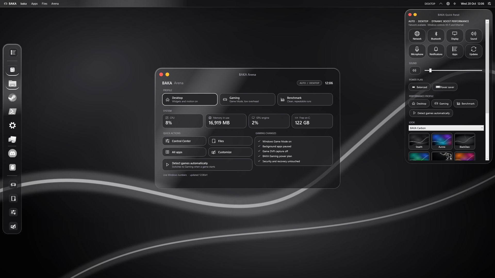
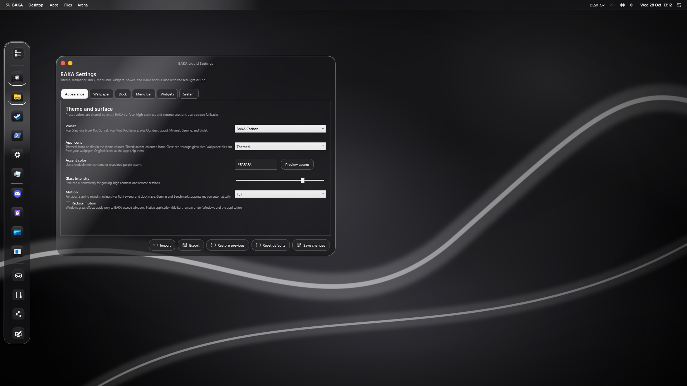
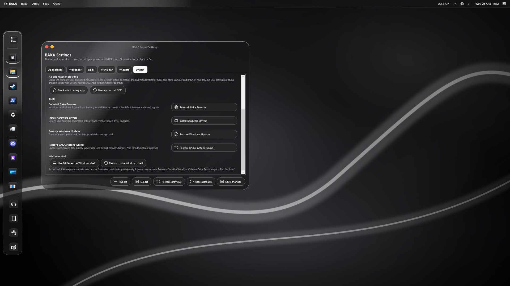
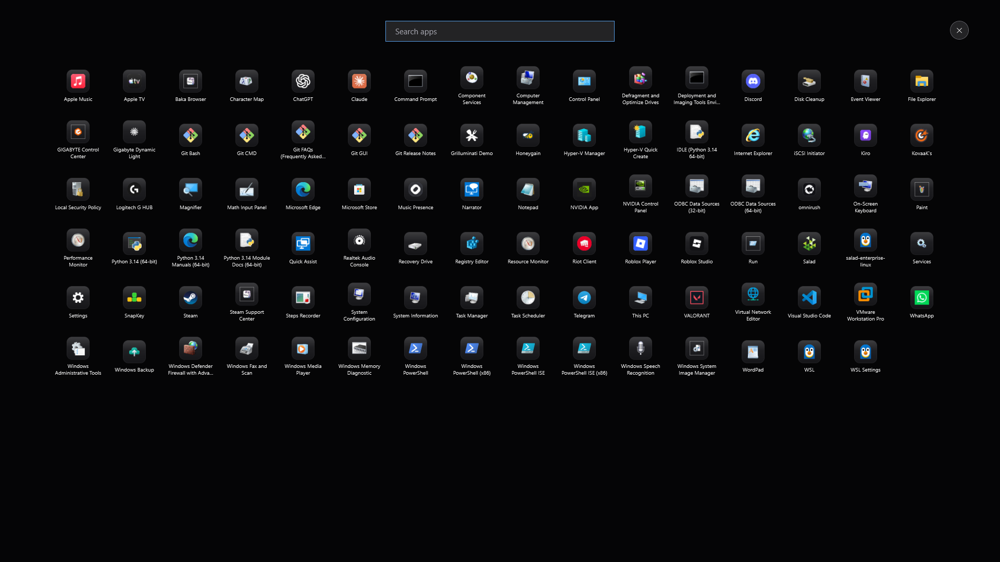
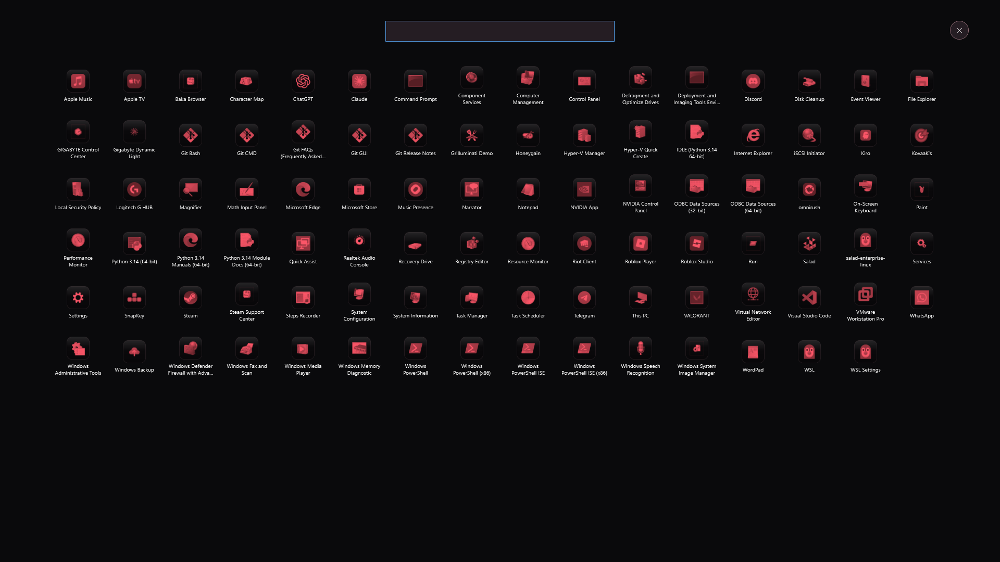
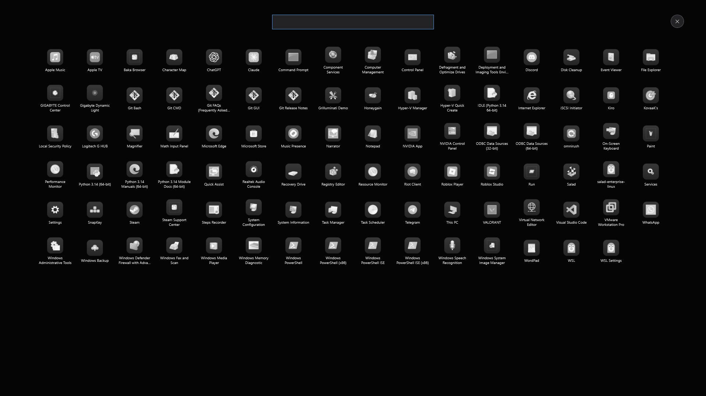
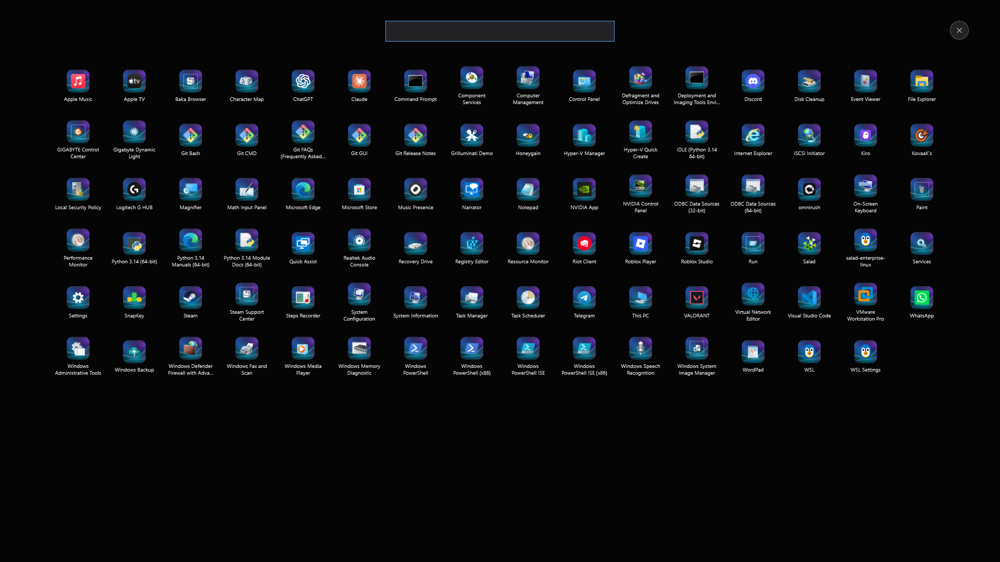
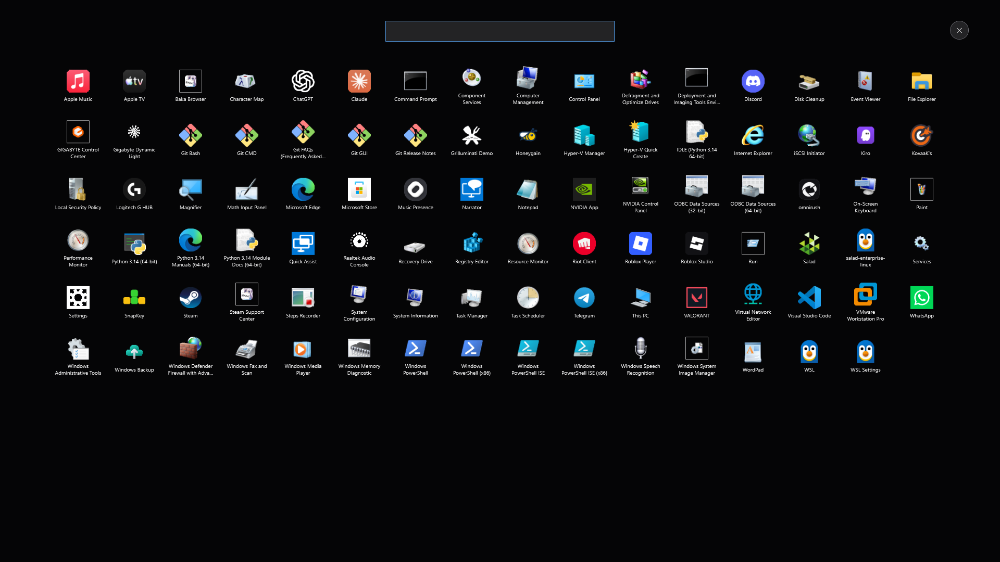

# BAKA Windows Gaming Edition

A custom Windows 11 Pro 26H2 (x64) image for gaming: its own compact graphite desktop instead of the taskbar, gaming and privacy tuning that can be undone, and [Baka Browser](https://github.com/OldcarryG/Baka-browser) as the default browser.

[](https://github.com/OldcarryG/Baka-windows/actions/workflows/source-validation.yml)



| BAKA Settings: app icon style | BAKA Settings: power plan and ad blocking | Baka Browser 1.5 with uBlock Origin Lite |
|---|---|---|
|  |  |  |

App icon styles (BAKA Settings > Appearance > App icons, or Control Center > Look):

| Themed (default) | Tinted (accent colour, here Carbon Red) | Clear (see-through glass) | Wallpaper (tiles cut from the wallpaper) | Original |
|---|---|---|---|---|
|  |  |  |  |  |

These are design captures of the real desktop code rendered on the development PC, not photos of an installed system.

## What you get

**Desktop (replaces the Windows taskbar)**
- Left dock with your apps and open windows, a slim menu bar with clock, network, volume and Control Center.
- **Arena**: switch between Desktop, Gaming and Benchmark profiles, live CPU, memory, GPU and disk numbers, quick actions.
- **Control Center**: Wi-Fi, Bluetooth, display, sound, power plan, profile, theme and wallpaper.
- **Launchpad** with every installed app, **BAKA Files**, and **BAKA Settings** for theme, wallpaper, dock, menu bar and widgets.
- The **Windows key** opens the BAKA launcher; Win+key shortcuts still work and Ctrl+Esc still opens Start.
- **App icon styles** that follow the theme: Themed (each icon on a rounded tile in the theme's colours), Tinted (accent-coloured), Clear (transparent glass tiles), Wallpaper (tiles cut from your current wallpaper, redrawn when it changes) and Original. Changing the theme or accent redraws them.
- It runs as the Windows shell through a small native launcher (`BakaShell.exe`) that restarts it if it stops and falls back to Explorer after three failures. Recovery shortcut: Ctrl+Alt+Shift+E.
- System numbers (CPU, GPU, memory, disk, network) are read by a small native reader instead of PowerShell/WMI queries.
- Measured on the development PC (R11): the everyday desktop (dock and menu bar) averages 97 MB of memory and 0.5% CPU; with Arena open, 224 MB and 0.7% CPU.

**Gaming**
- Game Mode, hardware GPU scheduling, no background recording, raw mouse input, foreground CPU priority, no power throttling, optimizations for windowed games, no Sticky/Filter/Toggle Keys pop-ups.
- Network throttling for multimedia off, long paths on, faster menus, full-quality JPEG wallpapers, file extensions shown.
- **4K video:** the free AV1, VP9, HEIF and HEVC (Device Manufacturer) codecs are installed from Microsoft Store in the background at first sign-in.
- **BAKA Gaming power plan** (26 settings on an Ultimate Performance base, including hybrid-CPU scheduling that keeps games on performance cores, no E-core parking, a 15 ms CPU re-evaluation interval and no USB hub suspend). Settings a CPU does not have are skipped. Gaming and Benchmark profiles switch to it; Desktop switches back.
- Any game is detected automatically (Steam, Epic, GOG, EA, Ubisoft, Xbox, Riot, Battle.net, itch, or any fullscreen app), and the desktop steps back to below-normal priority while you play.

**Privacy and clean-up**
- 19 junk packages removed; telemetry services and tasks off; Copilot, Recall, ads ID, tips, suggestions, Start web search and Spotlight ads off.
- **Ad and tracker blocking for every app:** Windows uses encrypted AdGuard DNS (DNS-over-HTTPS, free). Your previous DNS is saved; BAKA Settings > System > "Use my normal DNS" or the restore shortcut puts it back.
- More privacy policies adopted from [Chris Titus Tech's winutil](https://github.com/ChrisTitusTech/winutil) (MIT): Edge telemetry and shopping off, device metadata downloads off, WPBT execution off, Notepad AI off, map auto-update off, speech/inking personalisation off.
- Boots straight to the desktop with no sign-in screen (set a password in Windows to get it back).
- Every change is backed up and undone with the "Restore BAKA System Tuning" shortcut.

**Baka Browser 1.5.0** is preinstalled and the default browser, with Chrome Web Store extensions, uBlock Origin Lite added on first start, and the same BAKA look.

## Status

The image builds and passes structural validation (Microsoft Setup signature, Windows 11 Pro 26300.9711, pinned Baka Browser hash, BAKA payload present). The latest build (R11) has **not** yet been installed in a VM; earlier builds (R5.3 and R7) were. Game performance has not been measured here. See [docs/CHECKLIST.md](docs/CHECKLIST.md) for every request and its verified status.

## Download

The ISO is about 11 GB and contains Microsoft's Windows media, so it is not attached to GitHub Releases (GitHub limits files to 2 GB, and Windows media is Microsoft's to distribute). Releases contain the BAKA payload, checksums and build instructions. To make the ISO yourself:

1. Download the official Windows 11 26H2 x64 ISO from Microsoft.
2. Install the Windows ADK Deployment Tools.
3. Follow [docs/GITHUB_WORKFLOW.md](docs/GITHUB_WORKFLOW.md) and run the build scripts in `Scripts/` (01 to 08). The pipeline refuses to overwrite an existing workspace or ISO.

## Source checks

```powershell
./Tests/Test-ProjectConfiguration.ps1 -SkipExternalArtifactChecks
./Tests/Test-DesktopConfiguration.ps1
./Tests/Test-SystemTuning.ps1
./Tests/Test-GamingProfiles.ps1
./Tests/Test-GameDetection.ps1
./Tests/Test-ReleasePipelineGuards.ps1
./Tests/Test-SystemMonitoring.ps1
./Tests/Test-DockContrast.ps1
./Tests/Test-BakaCompanionPreview.ps1        # opens the desktop in a throwaway preview and runs 25 UI stages
./Scripts/Diagnostics/Measure-CompanionPreview.ps1 -IdleDesktop   # memory and CPU of the everyday desktop
```

Preview mode (`Scripts/Runtime/BakaCompanion.ps1 -Preview`) uses a temporary profile and never changes the PC's real shell, taskbar or settings.

## Project layout

- `Scripts/` build pipeline, first-logon setup, runtime desktop (`Runtime/BakaCompanion.ps1`, `Runtime/BakaShell.cs`)
- `Modules/` desktop configuration, shell, power plan, tuning, monitoring
- `Config/` debloat, privacy, performance profiles, themes, applications (pinned Baka Browser installer)
- `Tests/` the checks above
- `docs/` checklist, decisions, design notes and evidence
