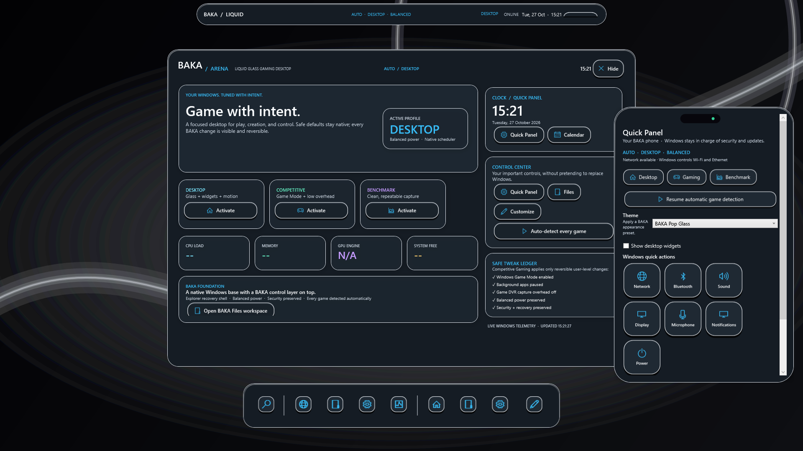
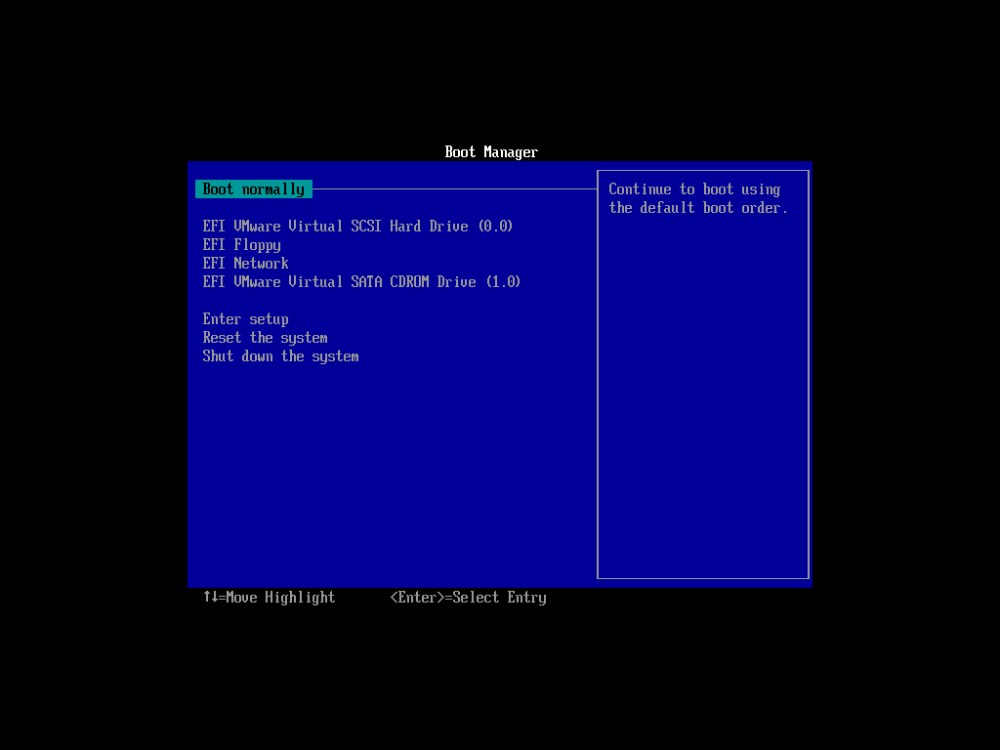
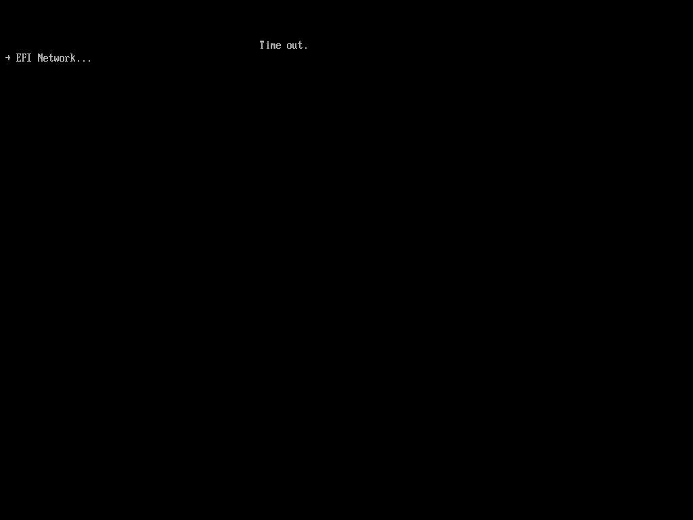

# BAKA Windows Gaming Edition

PowerShell-driven Windows 11 Pro x64 deployment project with Explorer as the shell, reversible gaming profiles, and the BAKA Liquid WPF desktop companion.

[](https://github.com/OldcarryG/Baka-windows/actions/workflows/source-validation.yml)

## Progress

**Acceptance checklist: 20 of 37 checks passed (54%).** This counts the tracked verification rows in `docs/ACCEPTANCE_MATRIX.md`, excluding its final release-summary row. The image is **not release accepted**.

`████████████████░░░░░░░░░░░░░░` 54%

Source/build validation and the BAKA Liquid source checks are complete. BAKA R3 Arena is now a substantial source redesign with a first-run dashboard, gaming control center, live telemetry, safe reversible profile tweaks, and animated dock. The current R2 ISO is preserved and is not the R3 build; it must not be described as containing this redesign. VMware installation of a rebuilt R3 image, game, resource-use, and comparative performance results remain pending; physical gaming results remain unavailable.

### 2026-10-27 R5 Pop Glass UI (source)

A new default look, **BAKA Pop Glass**, mixes SekaiPop's block language with Apple-style liquid glass:

- Every button, tile, and dock icon is a rounded keycap with a cream ring and a hard shadow straight down; it sinks when pressed and springs back.
- Glass surfaces have a bright specular rim on the top edge, a clearer body, and a soft light that follows the pointer.
- Things pop in on a spring and shrink away when closed. The Quick Panel is a phone (notch, app-style tiles) that bounces up from the bottom; Settings opens like that phone turning sideways. Dock icons hop when an app launches.
- The dock is icons only, like macOS. Arena shows once on first run and no longer reappears over your apps.
- All motion is event-driven (nothing animates while idle) and turns off in Gaming and Benchmark profiles.



The capture renders only BAKA surfaces over the BAKA wallpaper. The Windows 10 development host cannot show Desktop Acrylic, so surfaces appear opaque here; translucency needs installed Windows 11 verification.

### 2026-10-27 R4 Liquid Shell (source; not yet in an ISO)

- **Boots straight to the desktop.** Setup creates a passwordless local `BAKA` administrator and signs it in automatically; no sign-in page, Microsoft-account, or privacy screens. Set a password in Windows to bring the sign-in screen back. Disk selection stays interactive and TPM/Secure Boot are not bypassed.
- **Less bloat.** 19 exact consumer packages are removed (adds Bing Search, new Outlook, To Do, Power Automate, Get Help, Feedback Hub, Dev Home, Phone Link, Cross Device, Quick Assist, Xbox speech overlay) offline and again online at first logon. Xbox sign-in, Store, Security, codecs, and inbox tools are protected.
- **Privacy, no ads.** Telemetry upload services and tasks are disabled; Copilot, Recall, Start web search, activity history, tips, suggestions, and promoted apps are off. Everything is backed up and undone by the "Restore BAKA System Tuning" shortcut.
- **Baka Browser is the default.** It installs silently at first logon, registers with Windows, and becomes the http/https/HTML handler through the Windows default-associations policy.
- **Every game, not only the test titles.** System-wide: Game Mode, hardware-accelerated GPU scheduling, no background game recording, Windows "optimizations for windowed games", MMCSS Games-task priority, and raw mouse input (pointer precision off). Automatic Competitive Gaming switching now detects any game: named titles, any executable in a Steam/Epic/GOG/EA/Ubisoft/Xbox/Riot/Battle.net/Amazon/itch library, or a fullscreen/borderless foreground app; launchers, crash handlers, browsers, and video players are ignored. CS2 and TF2 remain the VMware test titles. All values are restorable; no FPS gain is claimed until measured on real hardware.
- **Taskbar replacement.** The dock adds Start, open windows with real icons, and auto-hides the Windows taskbar while BAKA runs.
- **Full customization.** Any image, looping video, or solid color as wallpaper; custom dock icons; existing themes, accent, glass, motion, widgets, and pinned apps.

Verification status for R4 is recorded in `docs/PROGRESS_REPORT.md`.

### 2026-10-27 R3 Arena redesign

The source now opens with **BAKA Arena**, a purpose-built gaming dashboard instead of only a floating utility panel. It includes Desktop, Competitive, and Benchmark profile cards, a safe-tweak ledger, live CPU/memory/GPU/disk telemetry, a large clock/Quick Panel zone, control-center and customization actions, a cyan/violet gaming visual system, a dark-glass wallpaper default, an Arena dock home button, and visible interaction animation. **BAKA Files** is now the normal file-browsing target behind the dock's Files entry, with real folder/drive navigation and file opening. Competitive Gaming now applies four reversible user-level changes: Windows Game Mode, background-app suppression, Game DVR capture suppression, and the existing optional composition reductions. Balanced power, native scheduling, Windows Security, recovery, servicing, the Explorer recovery shell, CS2/TF2 detection, and VALORANT exclusion remain preserved.

Research decisions and licenses are recorded in `docs/DESIGN_RESEARCH_20261027.md`.

Source preview evidence for the file workspace is `docs/evidence/screenshots/20261027-baka-files-source-preview.png`. The screenshot is source-preview evidence, not installed-image acceptance; the preserved R2 ISO predates this R3 Files workspace.

### 2026-10-27 source remediation

The companion reliability pass is complete at source level: action buttons now render their supplied Windows icon glyphs, manual profiles stop automatic game-process polling, profile UI failures attempt a backend/UI rollback, unopened Quick Panel state is guarded, settings import errors are reported, and shutdown cleanup state is initialized before event handlers run. The preview smoke remains **Passed, 13/13 stages**; isolated source preflight is **Passed, 79 checks with 3 explicitly skipped external-artifact checks**.

The latest R3 host preview sample averaged **0.583% CPU** (0.729% maximum) and **218.47 MiB working set** (221.10 MiB maximum) across 10 samples at two-second intervals after a three-second warm-up. CPU was within the initial target; working set exceeded the 150 MiB target. This is a Windows 10 development-host preview measurement, not an installed Windows 11 result. No FPS, latency, or physical gaming benefit is claimed.

### VMware boot evidence

The first screenshot shows the BAKA candidate's VMware UEFI boot manager with its ISO listed. The second shows the candidate back at the firmware manager after its EFI timeout; the third captures the stock ISO's “Time out” screen. These are boot-path evidence only; none is a screenshot of an installed desktop.






### Fresh VMware Setup evidence

A new disposable VMware acceptance VM reached a genuine Windows 11 Setup screen with the R2 ISO. Setup then reported the missing TPM 2.0 requirement. This is a boot/Setup observation, not an installation or desktop acceptance result.


Detailed configuration and limitations are recorded in `docs/evidence/VMWARE_ACCEPTANCE_20261027.md`.

## Release status

A separate BAKA Liquid UI-R2 candidate has been built in the authorized Windows 11 build VM and passed structural ISO validation. It is **not fully acceptance-tested**: a new disposable VMware run reached Windows Setup but stopped because the VM lacked TPM 2.0; the preserved AB shells and official source still show the earlier shared EFI timeout. Windows SIM, install/OOBE, installed desktop behavior, runtime security/update restoration, and game tests remain outstanding.

- Candidate: `Output/BAKA-Windows-Gaming-Edition-26H2-x64-BakaLiquid-UI-R2-20261024.iso`
- SHA-256: `55E6883CC303AE5AD8D22EDD3C8A7E9344C13498F6623A79F4D5D1D5DF877CD8`
- Size: 11,164,844,032 bytes

The original ISO and existing candidate remain unchanged:

- Candidate: `Output/BAKA-Windows-Gaming-Edition-26H2-x64-20261016.iso` — SHA-256 `830A4161DBE8C5EFAFDC6DCA19B8FE20571D057A5B97C8F5617EE21DE47A672D`
- Original: `Output/BAKA-Windows-Gaming-Edition-26H2-x64.iso` — SHA-256 `EC287E1B8FF0FCD59E7DFDF3C9A0B95BA83D133B2AE3A9EF64F8F54E44AC7BAB`

The earlier candidate does not contain the BAKA Liquid companion. The new candidate is the current artifact for review, not an accepted final release.

## BAKA Liquid desktop

One optional WPF companion provides the floating dock, optional status bar, Quick Panel, visual settings editor, five themes, and desktop widgets. BAKA Liquid is the default, with Windows Desktop Acrylic, layered silver highlights, brief spring-soft panel entrances, a one-shot glass light sweep, and pointer-focused dock magnification. Explorer remains the shell. Competitive Gaming and Benchmark use opaque surfaces and hide optional widgets and motion while preserving Windows’ Balanced power baseline, native scheduling, security, and reversible profile backend.

Themes: BAKA Obsidian, BAKA Liquid, BAKA Minimal, and BAKA Gaming are the required presets; BAKA Violet remains an optional accent variant. Core widgets: clock/date, calendar, Windows-backed system monitor, and optional local notes. Weather and media controls are deferred. Hardware controls open native Windows Settings pages rather than simulating a toggle.

Read `docs/BAKA_LIQUID_DESIGN.md` for architecture and limitations.

## Source checks

Run the isolated source checks from the project root on Windows:

```powershell
./Tests/Test-DesktopConfiguration.ps1
./Tests/Test-DockContrast.ps1
./Tests/Test-GameDetection.ps1
./Tests/Test-GamingProfiles.ps1
./Tests/Test-SystemMonitoring.ps1
./Tests/Test-ReleasePipelineGuards.ps1
./Tests/Test-BakaCompanionPreview.ps1
./Tests/Test-ProjectConfiguration.ps1
```

For a host-only companion resource sample (not installed-image acceptance), run:

```powershell
./Scripts/Diagnostics/Measure-CompanionPreview.ps1
```

The full project preflight requires the pinned source image, signed servicing packages, and the pinned Baka Browser installer to be present locally. These external inputs are excluded from GitHub. For a checkout without them, use `./Tests/Test-ProjectConfiguration.ps1 -SkipExternalArtifactChecks`; the skipped checks are reported explicitly. The isolated preview and release-guard checks do not build or modify Windows.

See `docs/GITHUB_WORKFLOW.md` for the branch, review, GitHub Actions, and release workflow.

## Build and acceptance

The build pipeline accepts explicit input and output paths and refuses to overwrite an existing workspace or ISO. The R2 build used the authorized Windows 11 technician VM and current ADK toolchain; any later rebuild must use a new output path and preserve the recorded artifacts.

The current candidate still requires a verified Windows Setup boot, Windows SIM validation, a clean UEFI installation and OOBE, installed runtime/security/update-restoration tests, and installed-image resource measurements. CS2/TF2 gameplay and physical gaming performance remain unverified. VALORANT is excluded. No BAKA FPS, frametime, or input-latency gain is claimed.

See `docs/BUILD_STATUS.md`, `docs/ACCEPTANCE_MATRIX.md`, and `docs/PROGRESS_REPORT.md` before using an ISO.

The VMware stock-vs-BAKA comparison is tracked in `docs/VMWARE_AB_COMPARISON.md`. VMware is installed and the two matched guest shells are preserved. A new disposable BAKA VM produced genuine Setup evidence; no installed-desktop screenshots, game runs, or guest resource measurements have been produced.
