# BAKA Windows Gaming Edition

A custom Windows 11 Pro 26H2 (x64) image for gaming. It replaces the taskbar, Start menu and File Explorer windows with its own desktop, draws its own icon for each app, removes apps most people never use, blocks ads and trackers for every app, and ships [Baka Browser](https://github.com/OldcarryG/Baka-browser) as the default browser.

[](https://github.com/OldcarryG/Baka-windows/actions/workflows/source-validation.yml)

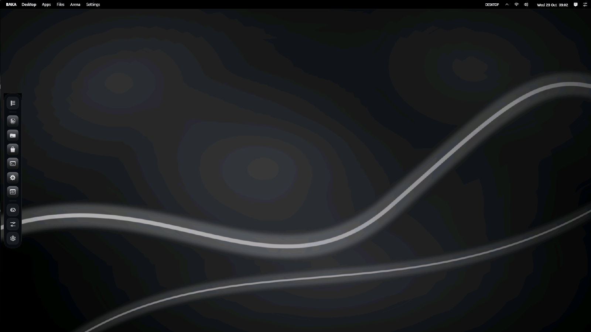

*The installed R12 image in a Hyper-V VM right after first sign-in: BAKA menu bar on top, dock on the left, no Windows taskbar.*

| Launchpad (Windows key) | Search | BAKA Files |
|---|---|---|
| 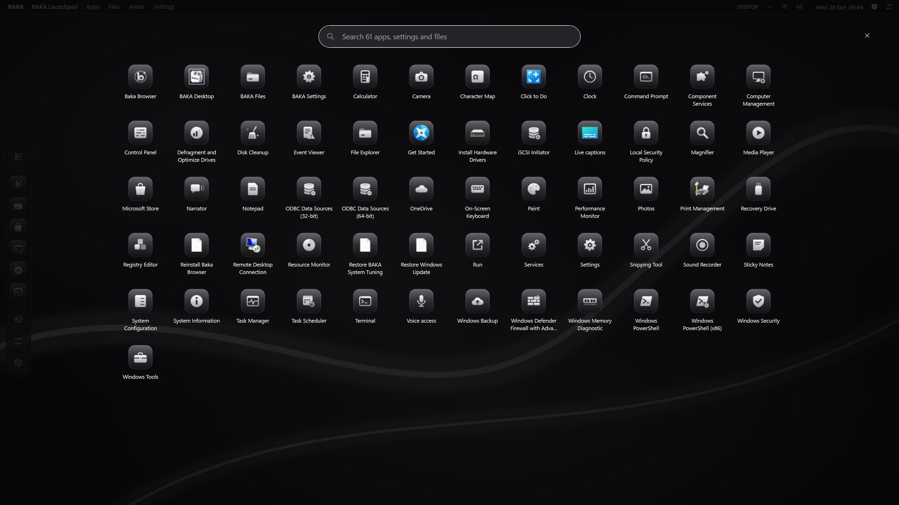 | 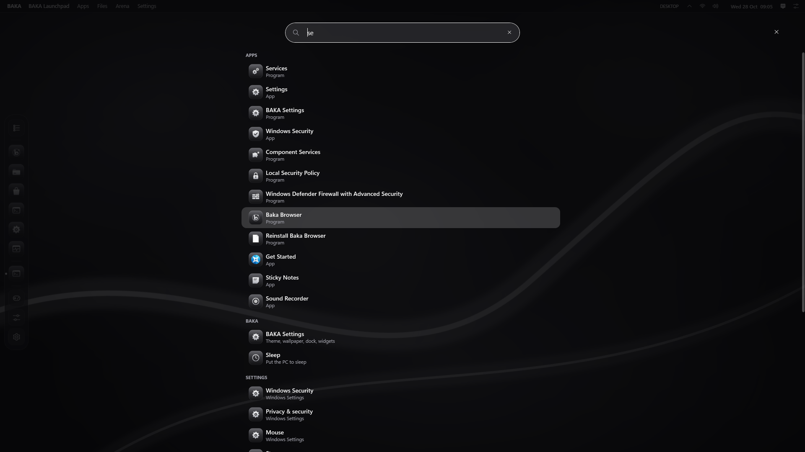 | 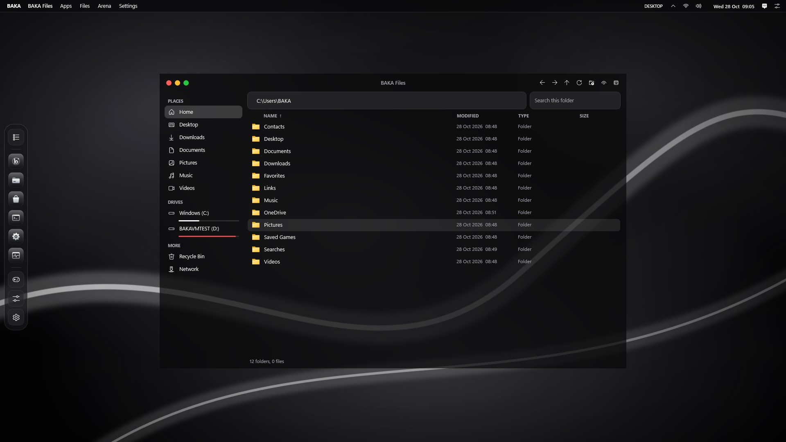 |
| **Control Center** | **BAKA Settings** | **BAKA Arena** |
| 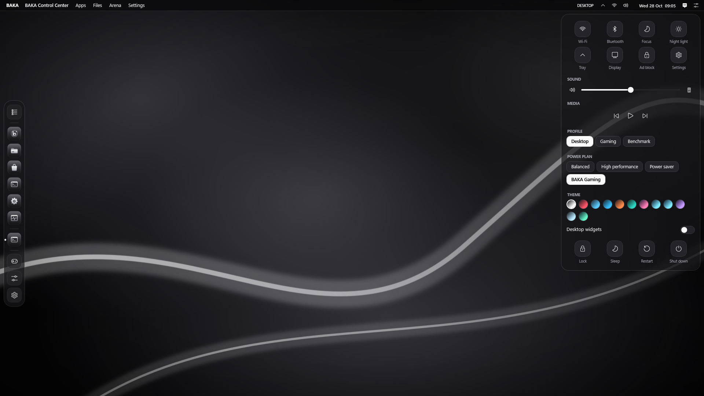 | 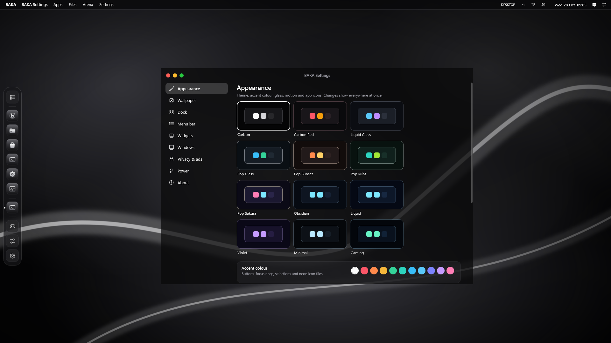 | 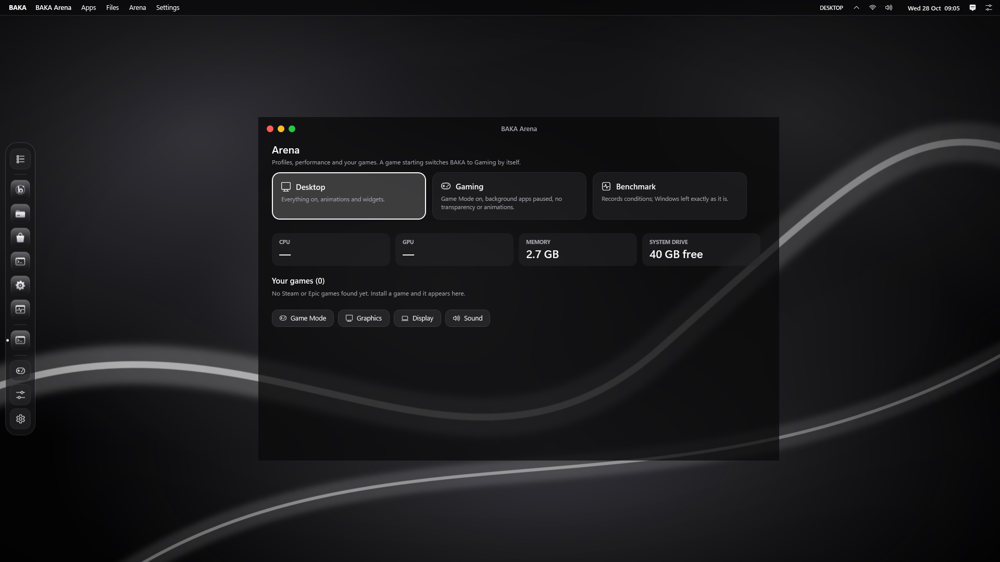 |

*These six were captured inside the installed VM by BAKA Desktop's own capture mode.*

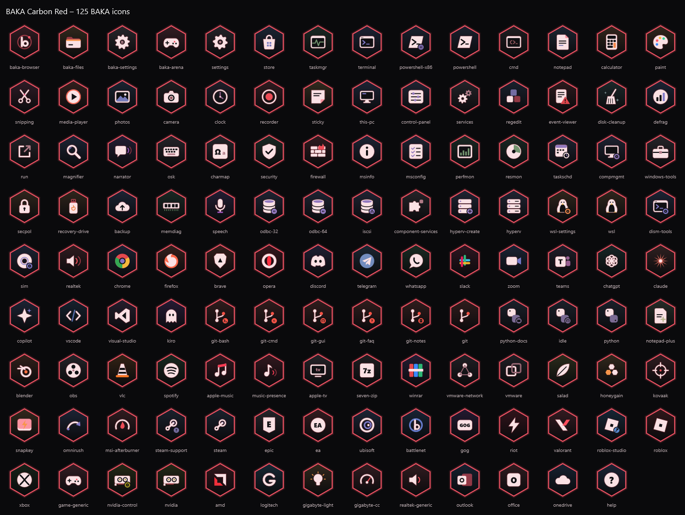

BAKA buttons on other apps, captured in the installed R13 VM (Notepad, Calculator, Media Player):

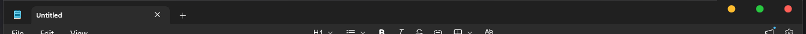
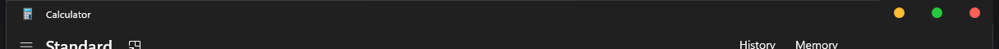
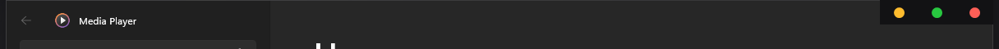

## What you get

**BAKA Desktop** replaces the taskbar, Start, desktop icons and File Explorer windows.
- A compiled app (C#/WPF on .NET Framework 4.8, which ships with Windows). No PowerShell runs for the desktop.
- File Explorer keeps running in the background only because Windows needs it for tray icons, notifications and file dialogs. You never see it: Win+E and folders opened from any app open in BAKA Files.
- It restarts itself after a crash. After three crashes in two minutes it gives back the normal Windows taskbar and desktop.
- **Menu bar** on top and **dock** on the left (or bottom or right). They reserve their screen edge like the Windows taskbar, so maximized windows never hide their close, minimize and maximize buttons under them. Fullscreen video and games cover them.
- **BAKA buttons on every app window**: amber, green and red minimize, maximize and close on Notepad, Store apps and most desktop apps. Nothing is loaded into the apps, so anti-cheat is not affected; hidden while a game runs.
- **Launchpad** (Windows key) lists every installed app. One search finds apps, Windows settings pages and your files. It tolerates a typo ("setings"), knows program names ("cmd", "regedit") and initials ("vsc").
- **BAKA Files**: places and drives with free space, sorting, search in subfolders, copy/cut/paste with the Windows clipboard, drag and drop, Recycle Bin, rename, new folder, ZIP, Open with, Properties, Terminal here.
- **125 hand-drawn app icons** in the style of each theme (metal squircles, neon hexagons, glass bubbles, candy keycaps and more). An app without one shows its own icon on a theme tile. "Original" shows icons as the apps ship them.
- **Control Center**, **BAKA Settings**, **BAKA Arena** (profiles, live performance numbers, every Steam and Epic game) and desktop **widgets** (clock, calendar, system monitor, notes, media controls, focus timer). 12 themes, accent colours, glass and motion levels.

**Gaming**
- A running game (Steam, Epic, GOG, EA, Ubisoft, Xbox, Riot, Battle.net, itch or any fullscreen app) switches to the Competitive Gaming profile: BAKA surfaces hide, transparency and animations go off, background apps pause, Game DVR is off. Everything comes back when the game closes.
- BAKA Gaming power plan, Game Mode, hardware GPU scheduling, raw mouse input, no Sticky/Filter/Toggle Keys pop-ups, optimizations for windowed games.
- Free AV1, VP9, HEIF and HEVC codecs from Microsoft Store for 4K video.

**Privacy, ads and clean-up**
- Ads and trackers blocked for every app: encrypted AdGuard DNS plus a BAKA block list in the Windows hosts file. BAKA Settings > Privacy & ads turns both off and restores your DNS.
- Telemetry services and tasks off. Copilot, Recall, advertising ID, tips, suggestions, Start web search and Spotlight off.
- Telemetry and inventory services off (DiagTrack, Inventory and Compatibility Appraisal, Windows Health and Optimized Experiences, Windows AI Components Host, Distributed Link Tracking), 16 telemetry tasks off.
- Microsoft Edge: BAKA uninstalls it and blocks its reinstall by policy. It stayed off in every R13 VM install; in R12 Windows put it back once. WebView2 is kept. Store apps built on Edge (Netflix) do not install while Edge is removed.
- Removed: Internet Explorer, the legacy Windows Media Player, Movies & TV, WordPad, Steps Recorder, Math Input Panel, Fax and Scan, PowerShell ISE, Clipchamp, Copilot, Maps, People, Family and 19 more consumer apps. Kept: Microsoft Store, Media Player, Photos, Paint, Notepad, Calculator, Snipping Tool, Terminal, Windows Security.
- Boots straight to the desktop with a passwordless local account (set a password in Windows to get the sign-in screen back). The "Restore BAKA System Tuning" shortcut undoes the tuning.

**Baka Browser 1.6.2** is preinstalled and the default browser: new-tab background image or video, tab menu, drag tabs to reorder or into a new window, mute button, Chrome Web Store extensions and uBlock Origin Lite.

## Tested in virtual machines

Stock Windows 11 and BAKA were installed into identical Hyper-V VMs (Gen 2, Secure Boot, virtual TPM, 4 vCPU, 6 GB), restarted, left idle for 10 minutes and measured the same way. BAKA was measured in Desktop mode and again in Gaming mode (what a running game switches to):

| | Stock Windows 11 | BAKA R13 Desktop mode | BAKA R13 Gaming mode |
|---|---:|---:|---:|
| Ads and trackers blocked (d3ward list, 131 domains) | 2 (1.5%) | **131 (100%)** | |
| Privacy checks passed | 0 of 12 | **12 of 12** | |
| Memory in use at idle | 2295 MB | 2354 MB | **2242 MB** |
| Processes / running services | 138 / 99 | 135 / 98 | **130 / 97** |
| Idle CPU | **3.6%** | 13.5% | 5.0% |
| BAKA Desktop's own CPU / memory | – | 0.03% / 43 MB | 0.03% / 39 MB |
| CPU (SHA-256, MB/s) / memory copy (MB/s) | 1850 / 14512 | 1855 / 17498 | 1874 / 17081 |
| Disk write (MB/s) | 1140 | 1431 | 1442 |
| Boot (Windows boot event) | 29.3 s | 26.5 s | |

Performance and footprint score **91.8 in Desktop mode and 101.9 in Gaming mode**, where 100 means the same as stock. In Gaming mode BAKA uses less memory and fewer processes than stock, and BAKA Desktop itself uses 0.03% CPU. Idle CPU is still higher than stock; it is not BAKA Desktop, and the cause was not found. Game FPS cannot be measured in a VM.

The full comparison with stock Windows is in [docs/BAKA_VS_WINDOWS.md](docs/BAKA_VS_WINDOWS.md). What changed in this release, the bugs the tests found and what is still not verified are in [docs/RELEASE_NOTES_R13.md](docs/RELEASE_NOTES_R13.md).

## Download

The ISO is about 11 GB and contains Microsoft's Windows media, so it is not attached to GitHub Releases (GitHub limits files to 2 GB, and Windows media is Microsoft's to distribute). Each [release](https://github.com/OldcarryG/Baka-windows/releases) lists the SHA-256 of the ISO it describes. To build the ISO yourself:

1. Download the official Windows 11 26H2 x64 ISO from Microsoft.
2. Install the Windows ADK Deployment Tools and the .NET SDK (BAKA Desktop is compiled during the build).
3. Follow [docs/GITHUB_WORKFLOW.md](docs/GITHUB_WORKFLOW.md) and run the build scripts in `Scripts/` (01 to 08). The pipeline refuses to overwrite an existing workspace or ISO.

Setup keeps disk selection interactive, so the image never erases a disk on its own. TPM 2.0 and Secure Boot are required, as on stock Windows 11.

## Source checks

```powershell
./Tests/Test-ProjectConfiguration.ps1 -SkipExternalArtifactChecks
./Tests/Test-DesktopConfiguration.ps1
./Tests/Test-SystemTuning.ps1
./Tests/Test-GamingProfiles.ps1
./Tests/Test-GameDetection.ps1
./Tests/Test-ReleasePipelineGuards.ps1
./Tests/Test-DockContrast.ps1
./Tests/Test-BakaDesktop.ps1     # builds BAKA Desktop and clicks through every surface in a throwaway preview (48 checks)
```

`BakaDesktop.exe --preview` runs the desktop with a temporary profile and never changes the PC's taskbar, settings, registry or wallpaper. `--capture <folder>` saves design screenshots, `--icon-sheet <folder>` renders the icon set in every theme, `--status <file>` writes what the desktop looks like as JSON, `--profile gaming|desktop` switches the profile, `--tray` shows the tray icons, and `--restore-windows` puts the normal Windows desktop back.

## Project layout

- `Shell/BakaDesktop/` the desktop (C#): menu bar, dock, Launchpad, Files, Settings, Control Center, Arena, widgets, icons, Explorer integration, ad blocking
- `Scripts/` build pipeline and first sign-in setup
- `Modules/` power plan, system tuning, update control, gaming profile rules (used by the setup scripts and tests)
- `Config/` answer file, debloat, privacy, block list, performance profiles, themes, applications (pinned Baka Browser installer)
- `Tests/` the checks above
- `docs/` comparison with stock Windows, release notes, checklist, decisions, screenshots
