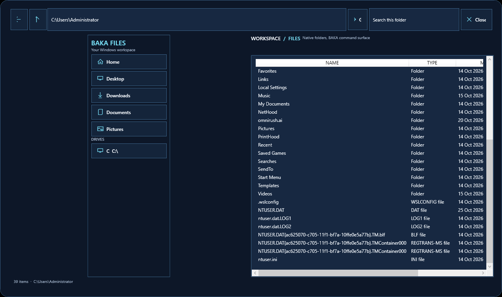

# BAKA R3 UI evidence — 2026-10-27

## Implemented source surfaces

- **BAKA Arena:** primary gaming dashboard with profile switching, clock, Quick Panel access, live Windows telemetry, safe-tweak ledger, and customization entry point.
- **BAKA dock:** Arena, Files, pinned applications, Control, and Customize actions with hover wave and running indicators.
- **BAKA Files:** a real WPF file-management workspace with known-folder navigation, filesystem drives, address bar, back/up navigation, current-folder search, details listing, directory navigation, and registered application opening.
- **Quick Panel:** profile controls, clock context from Arena, theme/widget controls, Windows Settings links, and native-control boundaries.

## Screenshots

`20261027-baka-files-source-preview.png` is a genuine source-preview window capture of BAKA Files reading the development host's user folder. It is not an installed Windows image screenshot.

## Verification

The preview smoke test launches the real WPF process and now checks that BAKA Files is constructed, visible, has a readable workspace, and closes cleanly. The current run passed 15 required stages. The isolated preview uses a temporary settings directory and simulated profile registry, so it does not change the development host's Windows profile.

The preserved R2 ISO was built before the R3 Arena/Files changes. A new Windows 11 technician build and installed VMware guest are required before this source can be claimed as the installed desktop or Explorer replacement.
