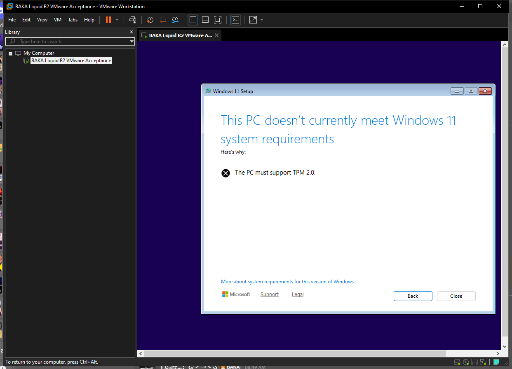

# VMware acceptance evidence — 2026-10-27

## Disposable VM

| Item | Observed configuration |
| --- | --- |
| Hypervisor | VMware Workstation Pro 26H1, `vmrun` available |
| VM purpose | New disposable BAKA acceptance VM; preserved AB shells and existing user VM were not modified |
| CPU / memory | 4 vCPU / 12 GiB |
| Firmware | UEFI with Secure Boot enabled |
| Storage | New 80 GiB growable test VMDK |
| Installation media | BAKA Liquid UI-R2 candidate ISO attached as IDE CD-ROM |
| Candidate | `Output/BAKA-Windows-Gaming-Edition-26H2-x64-BakaLiquid-UI-R2-20261024.iso` |
| vTPM | Not present during this run |

## Result

**Passed — VMware reached a genuine Windows 11 Setup screen.** Secure Boot approved the candidate loader, and the VMware guest console displayed Windows 11 Setup. The Setup screen reported that the PC does not meet Windows 11 requirements because TPM 2.0 is missing.

Screenshot SHA-256: `E712042C81EE0F7A486D30CF737E161F02AC3207600B5860B7DF12E5F1339A3A`

This is boot and Setup evidence only. It is not an installation, OOBE, desktop, BAKA Liquid runtime, profile, security, or game pass.

## vTPM limitation

VMware Workstation partially encrypted the disposable Windows 11 VM when it was first started. After the test, CLI reopen/capture operations required the VMware encryption password, which was not available to the automation session. VMware's supported path is to open the disposable VM in Workstation, provide the encryption password, add a Trusted Platform Module device, and then repeat Setup. No unsupported `vmx` TPM bypass was used. The unrelated existing `Windows 11 x64` VM was left running and untouched.

## Evidence interpretation

- The earlier Hyper-V and preserved VMware AB attempts still document a shared pre-Setup timeout for the candidate and official source.
- This new disposable VMware VM provides direct candidate evidence that the ISO can reach Windows 11 Setup under VMware when the media is attached to a new UEFI VM.
- Installation remains blocked by missing vTPM; no disk partitioning or destructive action was performed.
